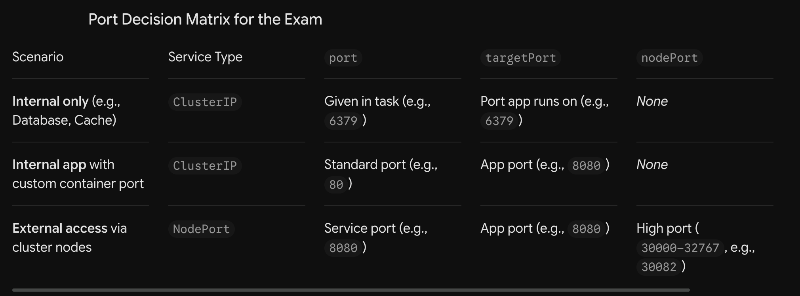

We need to answer three specific questions based on where the traffic is comming from ahd where it is going: 

The Three Ports Explained
1. targetPort: The Container's Application Port
What it is: The actual port the application process inside the container is bound to.

How to find it:

Look at the Pod/Deployment definition under spec.containers[*].ports[*].containerPort.

Check the application configuration or Docker image default (e.g., standard Nginx is 80, standard Redis is 6379, standard PostgreSQL is 5432, custom Node/Java/Python apps are often 8080, 3000, or 5000).

If an exam question says: "The web app listens on port 8080", then targetPort: 8080.

2. port: The Service's Internal Virtual Port
What it is: The port that other Pods inside the cluster use to reach the Service via its ClusterIP or DNS name (my-service:port).

How to find it:

In exam questions, this is explicitly specified: "Expose the service on port 80" or "Port: 6379".

In real architectures, standard protocol ports are usually chosen (e.g., 80 for HTTP, 443 for HTTPS, 6379 for Redis), even if the container underneath uses a non-standard port like 8080.

If omitted in YAML, Kubernetes defaults targetPort to match port.

3. nodePort: The Node's External Entry Port
What it is: A dedicated port opened on the host network interface of every node in the cluster, allowing outside users to access the workload using <Node-IP>:<nodePort>.

How to find it:

Must fall strictly within the default Kubernetes node port range: 30000–32767.

In exam tasks, if required, the question will state it explicitly: "accessible on port 30082 on the nodes of the cluster".

If you configure type: NodePort without specifying nodePort, Kubernetes will randomly assign an unused port between 30000 and 32767.

| Scenario | Service Type | `port` | `targetPort` | `nodePort` |
| :--- | :--- | :--- | :--- | :--- |
| **Internal only** (e.g., Database, Cache) | `ClusterIP` | Given in task (e.g., `6379`) | Port app runs on (e.g., `6379`) | *None* |
| **Internal app** with custom container port | `ClusterIP` | Standard port (e.g., `80`) | App port (e.g., `8080`) | *None* |
| **External access** via cluster nodes | `NodePort` | Service port (e.g., `8080`) | App port (e.g., `8080`) | High port (`30000–32767`, e.g., `30082`) |